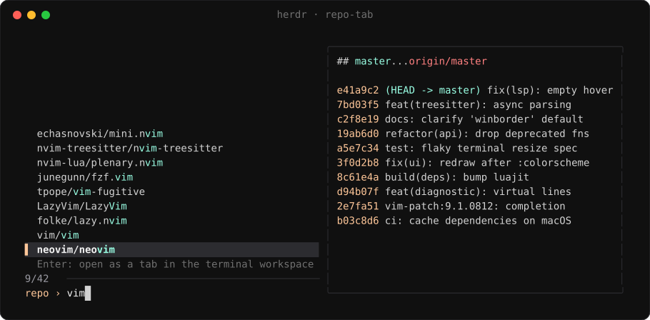

# repo-tab

A [herdr](https://herdr.dev) plugin that lets you fuzzy-find your
[ghq](https://github.com/x-motemen/ghq) repos and open one as a **tab** in a
single workspace. Picking a repo that already has a tab jumps to that tab
instead of opening another.

The picker opens as an overlay. It shows each repo as `owner/repo`, with a
preview of `git status` and the last ten commits.



## Requirements

- herdr 0.9 or later
- [fzf](https://github.com/junegunn/fzf) and [jq](https://jqlang.org)
- ghq (optional). Without it, repos are looked for at `~/ghq/<host>/<owner>/<repo>`.

## Install

```sh
herdr plugin install thomaspmurphy/herdr-repo-tab
```

Then bind the action to a key in your herdr `config.toml`:

```toml
[[keys.command]]
key = "prefix+f"
type = "plugin_action"
command = "repo-tab.open"
description = "ghq repo picker"
```

## Configuration

Tabs go in a workspace called `terminal`. Set `REPO_TAB_SPACE` in the
environment herdr starts from to use a different one. A workspace counts as a
match if its label is the name exactly, or the name after an icon and two
spaces (`<icon>  terminal`). If none matches, it is created.

If you use cockpit, its own script creates the workspace, so it keeps cockpit's
label and icon.

## License

MIT
